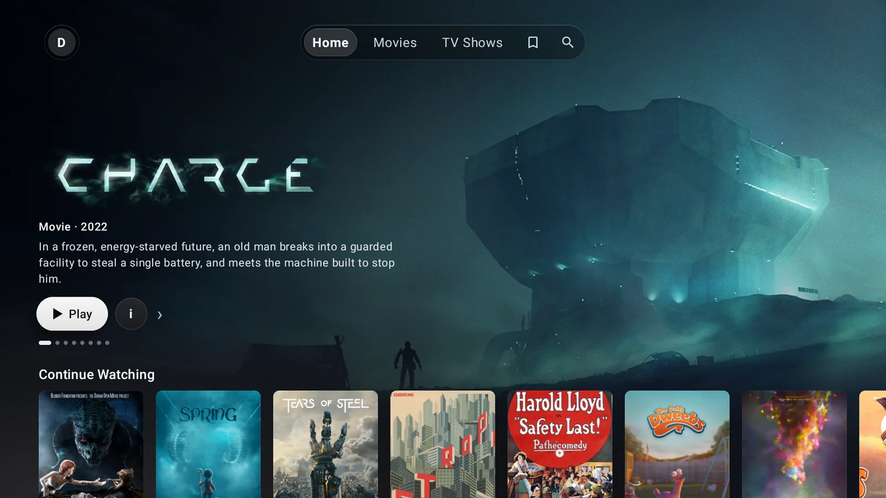
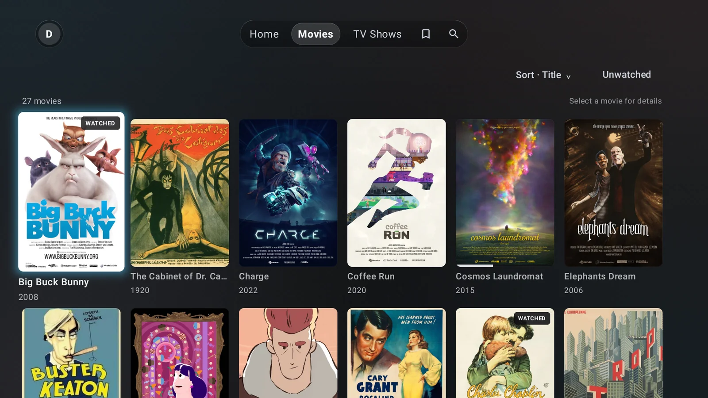

# Dooplex

A fast and modern Plex client made for Zidoo media players. It is developed and tested on a Zidoo
Z9X 8K, and may also run on other Android TV devices (Android 11 or newer).

## Why Dooplex

Zidoo's own media browser is sluggish and wants your files over SMB or NFS, even when a Plex server
already has them organized. Plex clients fix the library but not the playback: their players
transcode or drop quality, or their interface is a chore with a remote. Dooplex takes the best of
both:

- **Zidoo's native player.** Dooplex browses Plex and hands the file to Zidoo's own player, so
  Dolby Vision, HDR and lossless audio passthrough work just like they do on the box.
- **A fast client with a good interface.** Built for the remote and tuned to stay smooth on the box:
  posters load quickly, scrolling keeps up, and everything is a few clicks away.





## Installation

1. Download the APK from the [latest release](https://github.com/jackra1n/Dooplex/releases/latest).
2. Install it on the Zidoo, either way works:
   - Open `http://<zidoo-ip>:18888` in a browser on the same network and upload the APK. The page
     may report an error even though the install worked.
   - Copy it to a USB drive and open it in the Zidoo's file manager.
3. Open Dooplex, scan the QR code or enter the code at [plex.tv/link](https://plex.tv/link), then
   pick your server.

Playback goes to Zidoo's own player automatically; there is nothing to set up.

## FAQ

**Is Dooplex only for Zidoo?**
It is made for Zidoo and plays through Zidoo's own player. It also runs on other Android TV devices
with Android 11 or newer, but there it hands videos to the device's default player, which has to
decode them itself, and Plex only learns where you stopped once you close it.

**Will it work on my Zidoo?**
It is developed and tested on a Z9X 8K. Other Zidoo models on Android 11 or newer should work but
are untested; models still on Android 9 can't install it. If you try one, an issue saying how it
went is very welcome.

**Does it transcode?**
No, it always plays the original file. The box needs a connection to your server that keeps up
with the file's bitrate, which for 4K remuxes usually means the same home network.

**Does my watch progress sync with Plex?**
Yes. Plex shows what is playing, saves where you stopped and marks things as watched, just like
with any other Plex app.

**Do I need Plex Pass?**
Not to play from your own server at home. Outside your home network, Plex's usual rules apply.

**What about music, photos or live TV?**
Dooplex shows movie and TV show libraries only.

**How do I update?**
Download the new APK from the releases and install it the same way. It installs over the old
version and keeps you signed in.

## Building

```sh
mise run build       # app/build/outputs/apk/release/dooplex.apk
mise run upload      # build and install on a Zidoo (ZIDOO_URL in mise.local.toml)
mise run screenshot  # docs/screenshots/home.webp from the demo library on the TV emulator
```

## Thanks

Dooplex is heavily inspired by [plx-native](https://github.com/GLinnik21/plx-native), both in its
focus on performance and in its interface. Thanks for the inspiration and its amazing work.

## License

[GPL-3.0](LICENSE)

Dooplex is not affiliated with or endorsed by Plex, Inc. or Zidoo. Plex and Zidoo are trademarks of
their respective owners.
